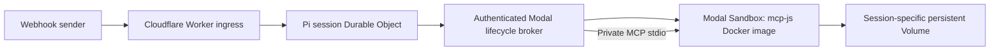

# Durable Pi + Modal

**Status: minimal live E2E verified on 2026-10-27.** Owner-only GitHub admin,
encrypted ChatGPT authorization, actual Pi 1.4.0 on Cloudflare, authenticated
checkpointed webhook runs, and real pinned mcp-js execution on Modal are deployed.
Three integrated runs proved file creation, sandbox-recreation persistence, and
two-session isolation; duplicate deliveries did not re-execute tools. See
[exact evidence](proofs/e2e-results.json), [results](proofs/RESULTS.md), and
[runtime operations](broker/README.md). This is separate from cuse-operator.

Current vertical slice intentionally uses **one owner Durable Object and one active
run globally**, not concurrent per-session orchestration. Each tool call creates and
terminates a sandbox; its named session Volume persists. Model/tool intents and
results are checkpointed, but interrupted ambiguous work fails closed instead of
blindly replaying side effects. It does not restore a live JavaScript heap.

The architecture below includes the original broader design; the operational
limits above and in `broker/README.md` describe what is deployed and proven.

**Admin login:** https://durable-pi-modal.rwendt1337.workers.dev/admin
First visit registers the private GitHub sign-in app; only GitHub account ID
`57335981` may finish setup and administer the ChatGPT connection.

## Architecture

- **Cloudflare Worker:** authenticate webhooks, enforce limits, map the authenticated tenant and conversation to a stable session, and acknowledge accepted events promptly.
- **Durable Object per Pi session:** persist inbox, agent transcript, goals, checkpoints, tool-call ledger, run budget, and sandbox lease metadata. Execute the Pi orchestration loop in bounded steps resumed by durable alarms. Pi on Workers is a proposed integration, not yet proven.
- **Modal lifecycle broker:** hold Modal credentials server-side and allocate, locate, renew, or terminate session sandboxes idempotently. This is an application-level broker, not an OpenClaw managed-worker integration.
- **Modal Sandbox per active session/hillclimb:** run the actual mcp-js server from its existing Docker image. Keep the process alive across tool calls for the bounded hillclimb, then terminate it.
- **Persistent Volume per session:** mount only that session's storage at `/data`; use `/data/workspace` for files and a separate subtree for supported engine persistence. Do not mount a shared tenant root and rely only on path conventions for isolation.

The engine runs on Modal Linux, not inside the Cloudflare Worker. This is deliberately a remote-engine architecture, not a claim that the native npm package embeds in Workers.

## Runtime image and protocol

Upstream: [r33drichards/mcp-js](https://github.com/r33drichards/mcp-js).

Image repository: `docker.io/wholelottahoopla/mcp-js`.

Select a tested release and pin its immutable image digest during implementation; never use a floating `latest` in production. Import the image using Modal's registry-image support and verify its user, entrypoint, dependencies, filesystem permissions, and process lifecycle are compatible. Do not assume Docker entrypoint behavior transfers unchanged.

The upstream Dockerfile exposes port 8080 with Streamable HTTP MCP at `/mcp`. Validate initialization, tool discovery, JavaScript execution, cancellation, and reconnect behavior against the pinned version. Expose the server only through an authenticated TLS endpoint; an unguessable tunnel URL is not sufficient authorization. Use session-scoped, expiring credentials and bind every request to the authenticated owner and active lease generation.

## Webhook and execution lifecycle

1. Validate sender authentication/signature, timestamp, replay window, payload size, and tenant permissions.
2. Store the event durably under a unique delivery ID before returning success. Duplicate deliveries return the existing receipt.
3. Serialize admission within the session. If a hillclimb is already active, queue the event rather than create another writer.
4. Obtain a bounded sandbox lease through the broker. Persist allocation intent and reconcile uncertain create outcomes before retrying; never blindly create a second sandbox after a timeout.
5. Attach the session Volume, start mcp-js, await readiness, authenticate, and establish its MCP session.
6. Resume Pi from its durable checkpoint. Record tool-call intent and results around execution. Ambiguous non-idempotent effects require reconciliation, not automatic replay.
7. Checkpoint progress periodically and enforce turn, tool, token, wall-clock, and compute budgets. Renew only within the authorized run budget.
8. On completion, cancellation, or deadline: cancel outstanding work, persist supported engine state, explicitly flush persistent files, record the final checkpoint, and terminate the sandbox.
9. Verify termination. Retain the Volume according to a documented retention policy; delete it only through an explicit authorized cleanup flow.

## Persistence and recovery

The Durable Object is authoritative for orchestration; the Volume is authoritative for session files. There is no cross-service atomic transaction: use checkpoint generations, manifests, and reconciliation to detect partial writes.

A persistent filesystem does **not** automatically preserve the V8 heap, open connections, background tasks, or external side effects. Use only engine checkpoint features demonstrated for the pinned image. Otherwise restore files and Pi state into a fresh engine, making the loss of volatile execution state explicit.

One active writer is allowed per session Volume. Use lease generations/fencing to reject stale results, and confirm an old sandbox is stopped before mounting its Volume in a replacement writer. A broker reconciliation path must recover leaked allocations after controller failures.

## Isolation, secrets, and budgets

- Derive session ownership from verified identity, never an unchecked webhook session ID.
- Separate sandboxes, volumes, MCP credentials, and engine policies across sessions.
- Grant mcp-js filesystem access only to its workspace and explicitly allow required network/tool capabilities.
- Keep Modal credentials in the broker; inject only narrowly scoped task credentials into sandboxes. Never persist secrets in transcripts or public logs.
- Enforce both maximum lifetime and idle cleanup. Open connections may prevent idle timeout, so idle cleanup alone is insufficient.
- Default to no warm sandboxes. Require verified included quota and blocking spending controls before allocation; stop when the free allowance cannot be guaranteed. No paid plan or Containers upgrade is implied.
- Bound CPU, memory, output size, concurrency, and retry count. Monitor active leases and storage retention separately from compute termination.

## Minimal proof / acceptance criteria

- [ ] Verify Modal access, image availability, runtime compatibility, and zero-out-of-pocket quota controls.
- [ ] Start the pinned mcp-js image in a bounded Modal Sandbox; initialize MCP and execute `6 * 7`, obtaining `42`.
- [ ] Run two sessions with distinct volumes and credentials; demonstrate cross-session authentication and file-access rejection.
- [ ] Write a file, flush, terminate, recreate, and read it back from the same session Volume.
- [ ] Demonstrate the documented engine-state recovery semantics; distinguish files from heap restoration.
- [ ] Deliver an authenticated webhook and drive one bounded durable Pi hillclimb through mcp-js.
- [ ] Retry the same webhook and interrupt allocation/execution; demonstrate deduplication, reconciliation, and no duplicate active writer.
- [ ] Demonstrate cancellation/deadline cleanup and verify no idle compute remains.

## Open implementation decisions

- Pi package/version and whether its orchestration dependencies run within Workers limits.
- Pinned mcp-js image digest, Modal image compatibility, and supported engine checkpoint mode.
- Broker hosting/authentication and endpoint credential enforcement.
- Volume provisioning limits, retention, deletion policy, and storage cost controls.
- Webhook source, signing format, tenant identity mapping, and result-delivery contract.

## References

- [Modal Sandboxes and lifecycle](https://modal.com/docs/guide/sandboxes)
- [Modal Sandbox filesystem and Volumes](https://modal.com/docs/guide/sandbox-files)
- [mcp-js Dockerfile](https://github.com/r33drichards/mcp-js/blob/main/Dockerfile)

The owner has authorized implementation and deployment, with a zero-out-of-pocket
spending limit. Account consent happens only in the private admin browser flow;
credentials must never be posted to IRC or stored in session volumes.
